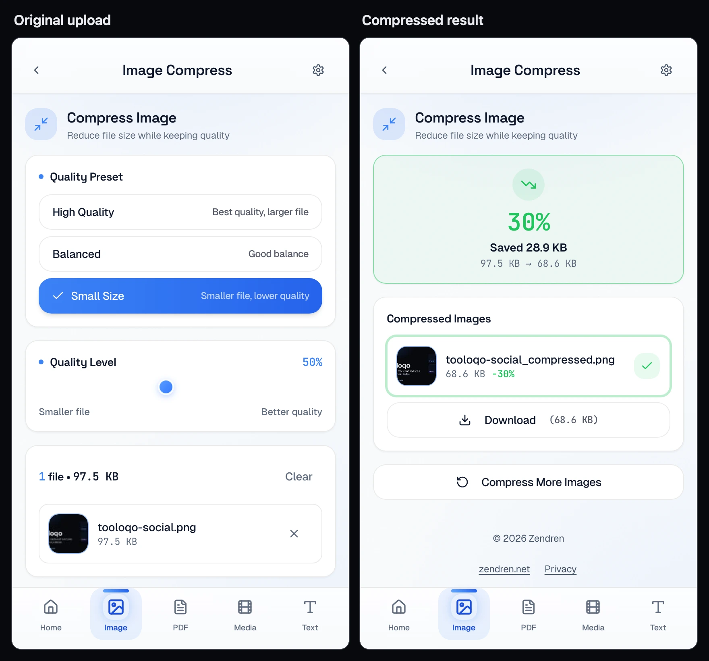
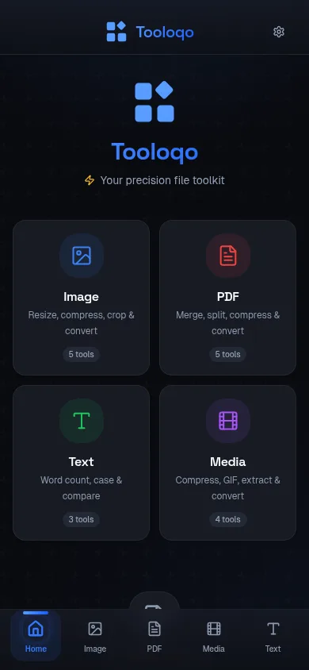
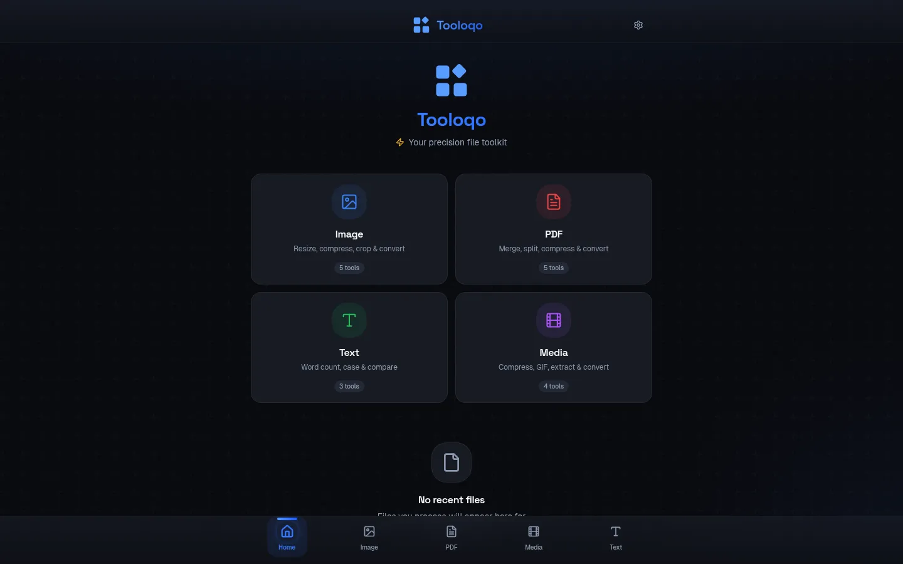

# Tooloqo

<div align="center">


</div>

Tooloqo is a free browser toolkit for anyone who needs to edit images, PDFs, audio, video, or text on their device.

[Open Tooloqo](https://tooloqo.zendren.net)

[](https://github.com/XanderXML-Bit/tooloqo-app/actions/workflows/ci.yml)

<div align="center">



</div>

<div align="center">

 

</div>

## What it does

- Resize, compress, crop, rotate, flip, and convert images.
- Merge, split, and compress PDFs, or convert between PDFs and images.
- Count words, change text case, and compare two versions of a text line by line.
- Compress video, make GIFs, extract audio, and convert audio formats.

## Stack

React 19, TypeScript 5.9, Vite 7, and Tailwind CSS 3.4 power the web app. React Router handles routes, and Zustand manages state. The tools use pdf-lib, PDF.js, and ffmpeg.wasm. Capacitor 8 wraps the app for iOS and Android.

## Run locally

Use Node.js 22, as pinned in [`.nvmrc`](.nvmrc). Run these commands from the repository root.

```sh
npm ci
npm run dev
```

Open [the local app](http://localhost:3000). For a production build, run `npm run build`, then `npm run preview`.

The development bridge exposes one browser alias, `window.__TOOLOQO`. To register it, run `await import('/src/api/index.ts')` in the browser console.

## Run checks

```sh
npm run lint
npx tsc -b
npx vitest run
npm run build
```

Vitest covers file processing, tool components, and application routes. CI checks production metadata and runs Chromium checks for media tools, downloads, and keyboard navigation.

## Architecture

React Router loads tools on demand. Components handle input and results, and services process files in the browser.
The service worker caches app assets for offline use. Media tools download the FFmpeg engine on first use.

[Read the architecture guide](ARCHITECTURE.md).

## Privacy

Tooloqo processes files on your device. It never uploads file contents. The web app is free of accounts, ads, and analytics. See [how Tooloqo handles your files](https://tooloqo.zendren.net/privacy).

## Brand

Tooloqo is part of Zendren's `-oqo` family. The wordmark uses Space Grotesk. The brand blue is `#3378FF`, and the gold accent is `#FBBF24`.

## License

The source code is proprietary. See [LICENSE](LICENSE) for the terms.
